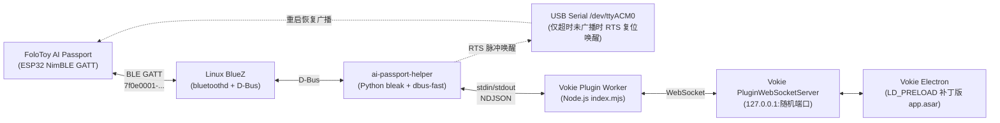

# Linux 下打通 Vokie 与 FoloToy AI Passport 蓝牙语音连接

> 适用环境：Ubuntu / Debian Linux（BlueZ 5.x + PipeWire/PulseAudio）、Vokie Linux 桌面端（Electron）、FoloToy AI Passport（ESP32 NimBLE 固件）

Vokie 官方外接设备插件（AI Passport / Mote）默认仅面向 macOS（提供 Swift CoreBluetooth Helper，且 Linux 端 Electron 客户端在主进程和渲染进程都屏蔽了外接设备页与插件 WebSocket 服务）。

本教程通过**零 root 侵入**的方式，在不修改 `/opt/Vokie` 系统文件的前提下，在 Linux 上完整打通 **FoloToy AI Passport ↔ BlueZ BLE ↔ Vokie 插件 Worker ↔ Vokie 桌面端 UI** 全链路。

> 💡 **强烈建议同步阅读 [PITFALLS.md](./PITFALLS.md)**，里面完整记录了我们在实机联调过程中踩到的 8 个隐蔽深坑（BlueZ 残留绑定导致服务发现秒断、ESP32 开机提示音时序冲突、Electron ASAR 完整性校验、`com.vokie.desktop` 自启抢占单例锁等）。

---

## 1. 整体架构



### 协议速览（Vokie Passport BLE GATT V1）

| 角色 | UUID | 方向 / 属性 | 用途 |
| --- | --- | --- | --- |
| Service | `7f0e0001-6a7b-4b6f-9d1a-564f4b494500` | Primary Service | Vokie 语音主服务 |
| Control | `7f0e0002-6a7b-4b6f-9d1a-564f4b494500` | Write + Notify | JSON 控制信令（`host_ready` / `host_state` / `ptt_down` / `ptt_up` / `button_event`） |
| Audio | `7f0e0003-6a7b-4b6f-9d1a-564f4b494500` | Notify | 16B 包头 + 166B IMA-ADPCM 音频分片（16kHz / 20ms） |
| Info | `7f0e0004-6a7b-4b6f-9d1a-564f4b494500` | Read | 设备 `hello` 握手 JSON |

---

## 2. 为什么需要三层改造？

1. **Vokie Electron 客户端层（无需 root）**
   - 原版 Linux 客户端在 `out/main/index.js` 中因为 `isLinuxRemoteOnly()` 跳过了 `pluginWebSocketServer.start()`，导致插件连不上宿主机；
   - `AiPassportDevicePresenter` 在 Linux 上硬编码 `supported: false`；
   - 渲染进程 `out/renderer/assets/main-*.js` 用 `!unref(isLinuxTarget)` 隐藏了整个 `.device-lab-page` 页面。
   - **解法**：利用 `/opt/Vokie/vokie` 未开启 `EnableEmbeddedAsarIntegrityValidation` 且 `chrome-sandbox` 非 SUID 的特性，使用 [scripts/asar_override.c](./scripts/asar_override.c)（`LD_PRELOAD`）将 `/opt/Vokie/resources/app.asar` 透明重定向到 `~/.config/vokie/app.asar`，并用 [scripts/patch-vokie-asar.py](./scripts/patch-vokie-asar.py) 原位字节级修补并更新 ASAR 头部 SHA256 完整性哈希。

2. **Linux BLE Helper 层（替代 macOS Swift Helper）**
   - [scripts/ai-passport-helper](./scripts/ai-passport-helper) 基于 `bleak` + `dbus-fast` 完整实现了与官方 Swift Helper 一致的 stdin/stdout NDJSON 协议；
   - 内置**三大 Linux 实战增强**：
     - **BlueZ 残留绑定自动自愈**：遇到 `failed to discover services, device disconnected` 时，自动通过 D-Bus 检测并清理旧的 `Paired/Bonded` 记录；
     - **先扫描、后唤醒的 USB RTS 复位策略**：先被动扫描 `4.0s`，仅当固件休眠停播时才发送 USB RTS 复位脉冲，并等待 `4.2s` 避开 ESP32 开机提示音窗口；
     - **设备 UUID ↔ MAC 可逆映射**：保证 Vokie UI 持久化保存的 `preferredDeviceId` 重启后可直接反推出设备 MAC。

3. **插件 Worker 守护层**
   - 官方 `worker/index.mjs` 在 helper 进程异常退出后会直接将插件置为永久失败；
   - 应用 [scripts/worker-auto-restart.patch](./scripts/worker-auto-restart.patch) 后，helper 退出会在 1 秒后自动拉起。

---

## 3. 快速部署步骤

### 前置依赖

```bash
sudo apt update
sudo apt install -y gcc python3 python3-venv bluez

# 创建独立 Python 虚拟环境并安装 bleak（会自动带入 dbus-fast）
python3 -m venv ~/.local/share/vokie-bridge/venv
~/.local/share/vokie-bridge/venv/bin/pip install --upgrade pip bleak
```

如果需要使用 USB 串口自动唤醒（`/dev/ttyACM0`），确保当前用户在 `dialout` 组：

```bash
sudo usermod -aG dialout "$USER"
# 重新登录生效
```

### 步骤 1：清理 BlueZ 可能残留的旧配对记录

如果之前在系统蓝牙设置里手动配对过 AI Passport，**务必先删除**：

```bash
bluetoothctl remove <你的设备MAC，例如 AA:BB:CC:DD:EE:FF>
```

> 原因详见 [PITFALLS.md #1](./PITFALLS.md#1-bluez-残留-pairedbonded-记录导致服务发现阶段秒断)。

### 步骤 2：部署 Linux Helper 与 Worker 补丁

假设你已在 `~/.config/vokie/plugins/<plugin-id>/` 下安装了 AI Passport 插件目录：

```bash
PLUGIN_DIR="$HOME/.config/vokie/plugins/<你的插件UUID>"

# 1. 安装 Linux BLE Helper
cp scripts/ai-passport-helper "$PLUGIN_DIR/assets/bin/ai-passport-helper"
chmod +x "$PLUGIN_DIR/assets/bin/ai-passport-helper"

# 如果你的 venv 不在默认路径，可修改第一行 shebang 指向你的 venv python3
sed -i "1s|^#!.*|#!$HOME/.local/share/vokie-bridge/venv/bin/python3|" \
  "$PLUGIN_DIR/assets/bin/ai-passport-helper"

# 2. （可选）为 worker/index.mjs 启用 helper 退出自动拉起
# 参考 scripts/worker-auto-restart.patch 修改 child.on('close', ...) 逻辑
```

### 步骤 3：配置补丁版启动器

```bash
chmod +x scripts/start-vokie.sh scripts/patch-vokie-asar.py

# 启动（首次运行会自动编译 libvokie_asar_override.so 并生成 ~/.config/vokie/app.asar）
./scripts/start-vokie.sh
```

> `start-vokie.sh` 会自动检测 `/opt/Vokie/resources/app.asar` 是否更新，Vokie 升级后会自动重新打补丁。

### 步骤 4：替换桌面图标与开机自启（推荐）

参考 [desktop/vokie.desktop.example](./desktop/vokie.desktop.example)，将 `Exec=` 指向你的 `start-vokie.sh` 绝对路径，分别复制到：

- `~/.local/share/applications/vokie.desktop`（应用菜单启动）
- `~/.config/autostart/vokie.desktop`（开机自启）

> ⚠️ **重要**：请务必关闭 Vokie 设置里的内置「开机自启」（或退出 Vokie 后将 `~/.config/vokie/app-settings.json` 中的 `"launchAtLogin"` 设为 `false`），并删除 `~/.config/autostart/com.vokie.desktop`。否则系统重启时 `com.vokie.desktop` 会按字母顺序抢先启动未打补丁的原版进程并占住单例锁（详见 [PITFALLS.md #8](./PITFALLS.md#坑-8系统重启后-comvokiedesktop-抢占-electron-单例锁导致补丁完全失效)）。

---

## 4. 验证与排查命令

### 检查 Vokie 是否加载了补丁版 ASAR

```bash
VOKIE_PID=$(pgrep -f '/opt/Vokie/vokie' | head -n 1)
ls -l /proc/$VOKIE_PID/fd | grep app.asar
# 应看到指向 ~/.config/vokie/app.asar
```

### 检查插件 Worker 与 Helper 进程

```bash
ps -ef | grep -E 'worker/index\.mjs|ai-passport-helper' | grep -v grep
```

### 检查 BlueZ 实时连接状态

```bash
busctl get-property org.bluez /org/bluez/hci0/dev_AA_BB_CC_DD_EE_FF \
  org.bluez.Device1 Connected ServicesResolved Paired Trusted
# 正常已连接时应为：
# b true   (Connected)
# b true   (ServicesResolved)
# b false  (Paired)
```

### 查看 Vokie 实时日志

```bash
tail -f ~/.config/vokie/logs/app.log | grep -E 'external-device|ai-passport|helper'
# 看到以下日志即代表完全打通：
# helper: helper: connected to Vokie Passport (AA:BB:CC:DD:EE:FF)
```

---

## 5. 目录清单

- [PITFALLS.md](./PITFALLS.md) — 8 大核心踩坑点与排查实录
- [scripts/asar_override.c](./scripts/asar_override.c) — 无 root `LD_PRELOAD` 文件路径拦截库
- [scripts/patch-vokie-asar.py](./scripts/patch-vokie-asar.py) — Electron ASAR 原位修补 + SHA256 哈希更新工具
- [scripts/start-vokie.sh](./scripts/start-vokie.sh) — 一键编译、打补丁与启动脚本
- [scripts/ai-passport-helper](./scripts/ai-passport-helper) — Linux BlueZ/bleak BLE Helper
- [scripts/worker-auto-restart.patch](./scripts/worker-auto-restart.patch) — Worker 自动重启补丁
- [desktop/vokie.desktop.example](./desktop/vokie.desktop.example) — 桌面与自启配置模板
